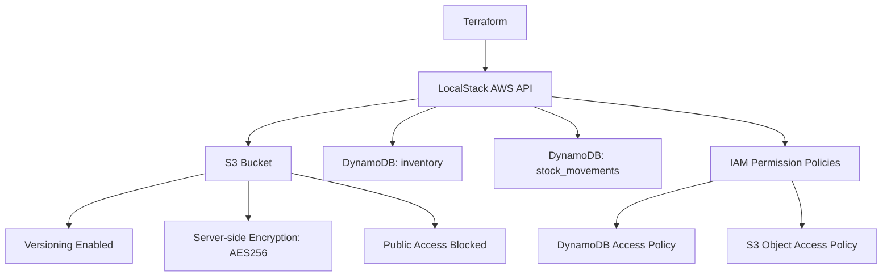

# AWS Infrastructure as Code

An Infrastructure as Code (IaC) project that provisions AWS infrastructure using **Terraform** and **LocalStack**.

The project demonstrates infrastructure provisioning, secure resource configuration, IAM least privilege, and independent infrastructure verification.

The infrastructure was developed and tested locally with LocalStack. It has not been deployed to a real AWS account.

## Technologies

- **Terraform** – Infrastructure provisioning and state management
- **LocalStack** – Local AWS service emulation
- **AWS CLI** – Resource verification and data operations
- **Docker** – Running LocalStack

## Architecture



## Infrastructure

### Amazon S3

One bucket for storing inventory-related files.

Security configuration:

- Versioning enabled
- Server-side encryption using AES256
- All four S3 public access block settings enabled

### Amazon DynamoDB

Two tables:

| Table | Partition key | Sort key | Purpose |
|---|---|---|---|
| `inventory` | `product_id` | — | Stores product information and current stock |
| `stock_movements` | `product_id` | `movement_id` | Stores stock movement history |

Both tables use `PAY_PER_REQUEST` billing mode.

### AWS IAM

Two permission policies implement least-privilege access:

**DynamoDB policy**
- `dynamodb:GetItem`
- `dynamodb:PutItem`
- `dynamodb:UpdateItem`
- `dynamodb:Query`

Permissions are scoped to the two DynamoDB tables.

**S3 policy**
- `s3:PutObject`
- `s3:GetObject`

Permissions are scoped to objects inside the inventory bucket.

No IAM role is created or attached in this project. A workload-specific role and trust relationship should be configured when an application deployment target is selected.

## Terraform Configuration

The Terraform configuration is located in:

```text
terraform/
└── environments/
    └── dev/
        ├── provider.tf
        ├── variables.tf
        ├── outputs.tf
        ├── s3.tf
        ├── dynamodb.tf
        ├── iam.tf
        └── terraform.tfstate
```

The state file is local and must not be committed to Git.

### Input variables

| Variable | Default | Description |
|---|---|---|
| `aws_region` | `us-east-1` | AWS region |
| `inventory_bucket_name` | `mazensaid-inventory-files` | S3 bucket name |

### Outputs

Terraform exposes:

- `inventory_bucket_name`
- `inventory_bucket_arn`
- `inventory_table_name`
- `stock_movements_table_name`

## Prerequisites

Install and configure:

- Docker Desktop
- Terraform
- AWS CLI
- LocalStack with the required services available

Make sure LocalStack is running and accessible at:

```text
http://localhost:4566
```

Use the LocalStack authentication configuration required by your installation.

## Deployment

Navigate to the Terraform environment:

```bash
cd terraform/environments/dev
```

Initialize Terraform:

```bash
terraform init
```

Format the configuration:

```bash
terraform fmt
```

Validate the configuration:

```bash
terraform validate
```

Review the execution plan:

```bash
terraform plan
```

Apply the configuration:

```bash
terraform apply
```

Confirm the deployment when prompted.

Display Terraform outputs:

```bash
terraform output
```

## Verification

The AWS CLI can independently verify the resources created by Terraform.

Configure dummy credentials for LocalStack:

```bash
export AWS_ACCESS_KEY_ID=test
export AWS_SECRET_ACCESS_KEY=test
export AWS_DEFAULT_REGION=us-east-1
```

List S3 buckets:

```bash
aws --endpoint-url=http://localhost:4566 s3api list-buckets
```

Check S3 versioning:

```bash
aws --endpoint-url=http://localhost:4566 s3api get-bucket-versioning \
  --bucket mazensaid-inventory-files
```

List DynamoDB tables:

```bash
aws --endpoint-url=http://localhost:4566 dynamodb list-tables
```

Describe the inventory table:

```bash
aws --endpoint-url=http://localhost:4566 dynamodb describe-table \
  --table-name inventory
```

List locally configured IAM policies:

```bash
aws --endpoint-url=http://localhost:4566 iam list-policies \
  --scope Local
```

## Security Considerations

- S3 public access is blocked.
- S3 server-side encryption is enabled.
- S3 versioning is enabled.
- IAM permissions are scoped to the required resources and actions.
- Terraform state files and sensitive local configuration must not be committed.
- LocalStack dummy credentials are used for local testing, not real AWS credentials.

## Cleanup

To remove the infrastructure managed by Terraform from LocalStack:

```bash
terraform destroy
```

Review the destruction plan carefully before confirming. This deletes the managed resources and can result in data loss.

## Project Scope

This project focuses on Terraform-based AWS infrastructure provisioning and security configuration.

CI/CD pipelines, application deployment, and workload-specific IAM roles are outside its scope and will be addressed in separate projects.

## Project Status

**Completed:** S3, DynamoDB, IAM permission policies, Terraform variables, Terraform outputs, and architecture documentation.

Infrastructure tested locally using Terraform, LocalStack, and AWS CLI.